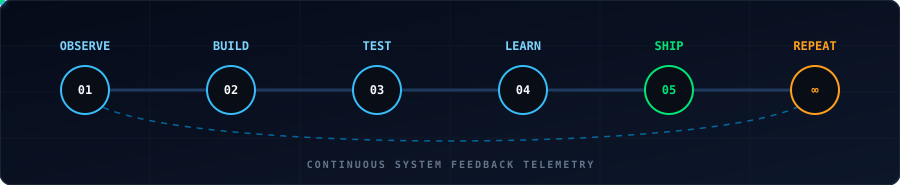
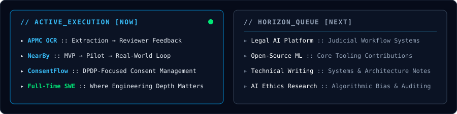
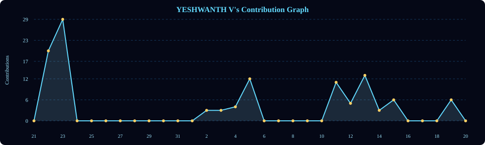

<div align="center">

<!-- CINEMATIC HERO BANNER -->


<!-- ANIMATED TERMINAL BOOT SEQUENCE -->
<a href="https://github.com/the-yesh21">
  
</a>

<br/>

<!-- TELEMETRY BADGES -->
<p>
  
  
  
  
</p>

</div>

<!-- ANIMATED DIVIDER PULSE -->


## `01 // THE ENGINEERING LOOP`

> *"I don't build to collect technologies. I build to understand systems."*

<div align="center">
  
</div>

<div align="center">
  <sub>Every project is a different way of walking around that loop.</sub>
</div>

<br/>

## `02 // SYSTEM PROFILE & CORE DIRECTIVES`

```yaml
engineer: "Yeshwanth V"
role: "SWE Intern · AI/ML Engineer · Final Year CSE @ Dr. Ambedkar Institute of Technology"
location: "Bengaluru, India"
focus: ["Applied Computer Vision", "Distributed Full-Stack", "Systems & Edge Inference", "Product Loops"]
north_star: "Build fewer demos. Build more systems that people actually use."
```

<table width="100%">
  <tr>
    <td width="25%" valign="top">
      <h4>⚙️ Engineering</h4>
      <sub>Clean architecture, useful abstractions, and systems designed to survive messy real-world usage.</sub>
    </td>
    <td width="25%" valign="top">
      <h4>🧠 Applied AI</h4>
      <sub>Computer vision, applied ML, intelligent automation, retrieval, and low-latency edge inference.</sub>
    </td>
    <td width="25%" valign="top">
      <h4>🚀 Product Loops</h4>
      <sub>Closing the continuous feedback circuit: <code>Input → Decision → Action → Feedback → Improvement</code>.</sub>
    </td>
    <td width="25%" valign="top">
      <h4>📚 First Principles</h4>
      <sub>Understanding <i>why</i> something works under the hood, not just making it run.</sub>
    </td>
  </tr>
</table>

<br/>

## `03 // ACTIVE DEPLOYMENTS (LIVE)`

<table width="100%">
  <tr>
    <td width="50%" valign="top">
      <h3>🏥 NearBy <kbd>CO-FOUNDER</kbd></h3>
      <p>Medical-delivery infrastructure being engineered from the ground up.</p>
      <p>
        
        
        
      </p>
      <sub><b>CURRENT VECTOR:</b> <code>MVP ➔ Pilot ➔ Real-World Feedback</code></sub>
    </td>
    <td width="50%" valign="top">
      <h3>🧾 APMC OCR Pipeline <kbd>SWE INTERN</kbd></h3>
      <p>Applied computer vision pipeline turning difficult APMC documents into structured information.</p>
      <p>
        
        
        
      </p>
      <sub><b>CURRENT VECTOR:</b> <code>Extraction ➔ Validation ➔ Reviewer Feedback</code></sub>
    </td>
  </tr>
</table>

<br/>

## `04 // INTERACTIVE PROJECT VAULT`

*Click any module below to expand system architectures and engineering takeaways.*

<details open>
<summary><b>⚡ SHIPPED & PRODUCTION SYSTEMS (EchoTune · MailPulse · Alma)</b></summary>
<br/>

| System | Core Stack | Engineering Focus |
| :--- | :--- | :--- |
| **🎵 EchoTune** | `React` · `Vite` · `Capacitor` · `Web Audio API` | Music app engineered for reliable web/Android foreground playback and native lifecycle resilience. |
| **📧 MailPulse** | `FastAPI` · `Groq` · `Kokoro TTS` · `Firebase` | AI-powered Gmail triage assistant using OAuth2, LLM classification, Firestore, and neural voice summaries. |
| **🎓 Alma** | `React` · `FastAPI` · `Gemini API` | AI-assisted Learning Management System architected and pitched directly to real clients. |

</details>

<details>
<summary><b>🧠 AI, COMPUTER VISION & EDGE INFERENCE (Veyron · Cognitive Stress · FairLens)</b></summary>
<br/>

| System | Core Stack | Engineering Focus |
| :--- | :--- | :--- |
| **🚗 Veyron** | `MediaPipe` · `ONNX` · `ESP32` · `FastAPI` | Edge inference pipeline optimized to run under tight hardware latency constraints. |
| **🧬 Cognitive Stress** | `XGBoost` · `MediaPipe` · `FastAPI` · `React` | Multimodal signal processing synchronizing face, voice, and biometric telemetry streams. |
| **🌍 FairLens** | `Gemini API` · `AIF360` · `NetworkX` · `React` | Graph-based auditing exploring social, behavioral, and ideological bias in AI systems. |
| **⚖️ Legal Priority ML** | `XGBoost` · `PostgreSQL` · `FastAPI` · `React` | Transforming unstructured legal case metadata into a calibrated priority scoring system. |
| **📄 Talk-to-PDF** | `Cohere` · `ChromaDB` · `LangChain` | Retrieval-augmented generation (RAG) pipeline for grounded question answering over documents. |

</details>

<details>
<summary><b>🛡️ SYSTEMS, SECURITY & SIMULATION (ARTEMIS · GRC · Smart Access)</b></summary>
<br/>

| System | Core Stack | Engineering Focus |
| :--- | :--- | :--- |
| **🪐 ARTEMIS Rover Sim** | `Three.js` · `TensorFlow.js` · `Cannon.js` | Browser-based autonomous navigation, pathfinding, sensor fusion, and 3D rigid-body physics simulation. |
| **🛡️ GRC · Kill CAPTCHA** | `Chrome MV3` · `JavaScript` · `ML` | Passive risk scoring and automated behavioral interaction signal analysis to eliminate intrusive CAPTCHAs. |
| **🔐 Smart Access Control** | `ESP32` · `C++` · `GSM` · `I²C` | Embedded hardware authentication and secure multi-protocol communication. |

</details>

<br/>

## `05 // ENGINEERING STACK MATRIX`

<div align="center">
  
</div>

<br/>

<table width="100%">
  <tr><td width="22%"><b>Frontend</b></td><td><code>React</code> · <code>Next.js</code> · <code>TypeScript</code> · <code>Tailwind CSS</code></td></tr>
  <tr><td><b>Backend</b></td><td><code>FastAPI</code> · <code>Node.js</code> · <code>Flask</code> · <code>PostgreSQL</code> · <code>MongoDB</code></td></tr>
  <tr><td><b>AI / Computer Vision</b></td><td><code>PyTorch</code> · <code>TensorFlow</code> · <code>XGBoost</code> · <code>OpenCV</code> · <code>MediaPipe</code> · <code>PaddleOCR</code></td></tr>
  <tr><td><b>Systems / Edge</b></td><td><code>C</code> · <code>C++</code> · <code>Linux</code> · <code>ESP32</code> · <code>Arduino</code> · <code>ONNX</code></td></tr>
  <tr><td><b>Delivery & Cloud</b></td><td><code>Docker</code> · <code>Git</code> · <code>Vercel</code> · <code>Supabase</code> · <code>Firebase</code></td></tr>
</table>

<br/>

## `06 // 2026 EXECUTION ROADMAP`

<div align="center">
  
</div>

<br/>

## `07 // TELEMETRY & WORK BEHIND THE PROFILE`

<div align="center">
  
  
</div>

<div align="center">
  
</div>

<details>
<summary><b>🏆 View Verified GitHub Trophies</b></summary>
<br/>
<div align="center">
  
</div>
</details>

<div align="center">
  <sub><i>Cards above are self-hosted via a scheduled GitHub Action (<code>.github/workflows/update-stats.yml</code>) to avoid shared rate limits — refreshed daily.</i></sub>
</div>

<br/>

## `08 // ENGINEERING PHILOSOPHY`

> A model is not a product. A UI is not a product. An API is not a product. A clever algorithm is not a product.
>
> **A product is the whole loop:** `input → decision → action → feedback → improvement`
>
> I don't want to know everything. I want to become the engineer who can enter an unfamiliar system, trace the moving parts, understand why it behaves the way it does, change it without breaking everything, and leave it better than I found it.

<br/>

<!-- ANIMATED DIVIDER PULSE -->


<div align="center">

### `09 // ESTABLISH UPLINK`

<a href="mailto:yeshwanth9750@gmail.com"></a>
<a href="https://linkedin.com/in/the-yesh21"></a>
<a href="https://github.com/the-yesh21"></a>
<a href="https://twitter.com/the_yesh21"></a>

<br/><br/>
<sub><code>SYSTEM_NOTE:</code> Build with curiosity. Measure with honesty. Improve without ego.</sub>


</div>
